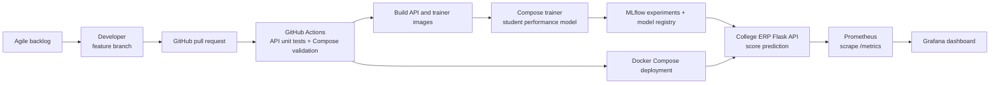

# Assignment 2 — College ERP DevOps architecture



## Workflow

Agile backlog items are implemented on Git branches and reviewed through GitHub pull requests. GitHub Actions runs API unit tests, validates the Compose configuration, builds the containers, trains and registers the model, deploys the stack, and smoke-tests the API and monitoring endpoints.

## Run locally

Docker Desktop with Docker Compose is required:

```bash
docker compose build
docker compose run --rm app python -m unittest -v test_api
docker compose up -d mlflow
docker compose --profile train run --rm trainer
docker compose up -d app prometheus grafana
```

The API is at `http://localhost:8000/health`, MLflow at `http://localhost:5000`, Prometheus at `http://localhost:9090`, and Grafana at `http://localhost:3000` (`admin` / `college-demo` by default; change `GRAFANA_PASSWORD` outside the demo).

Example student score prediction:

```bash
curl -X POST http://localhost:8000/predict -H "Content-Type: application/json" -d "{\"attendance_percent\":85,\"study_hours_week\":12,\"absences\":2}"
```

Stop the stack with `docker compose down`. See the GitHub Actions run for automated execution evidence; screenshots of a successful workflow, MLflow experiment, and Grafana dashboard can be attached to the submission.
